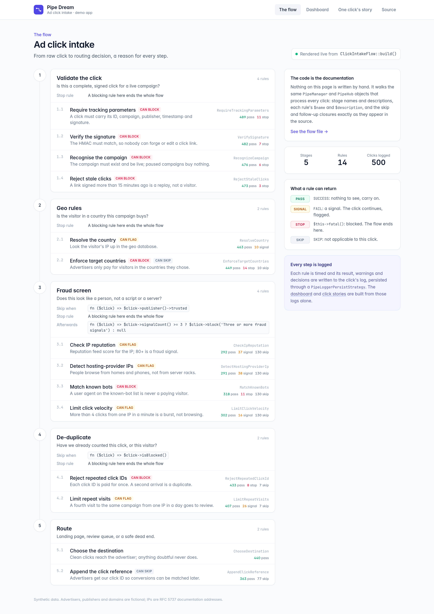
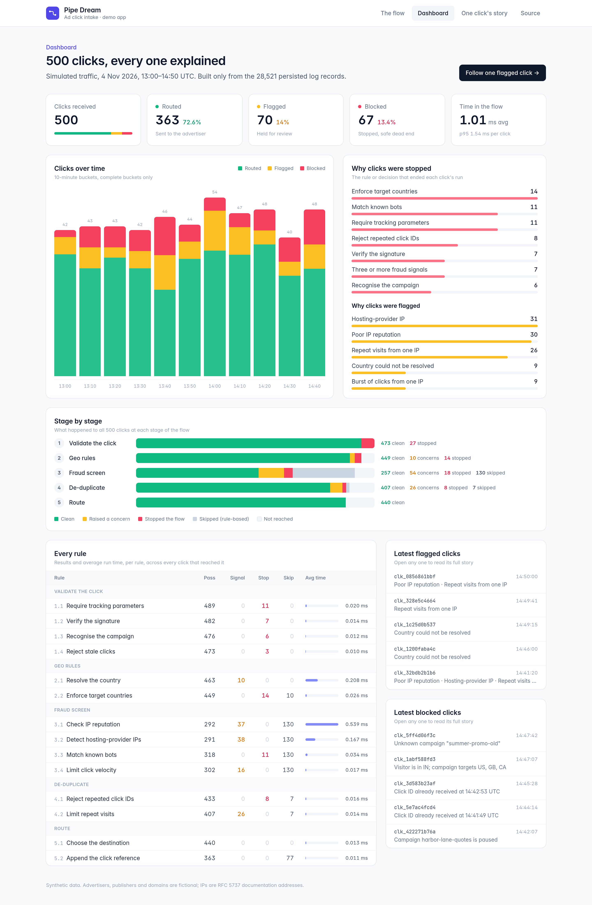
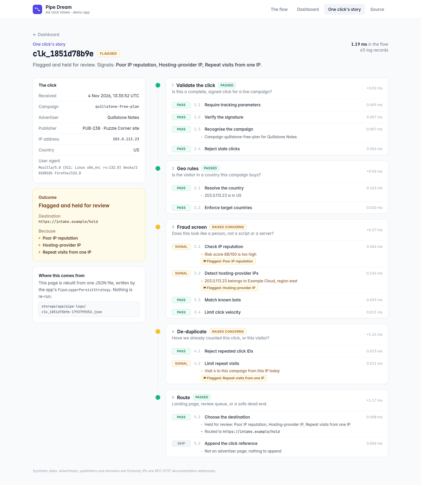
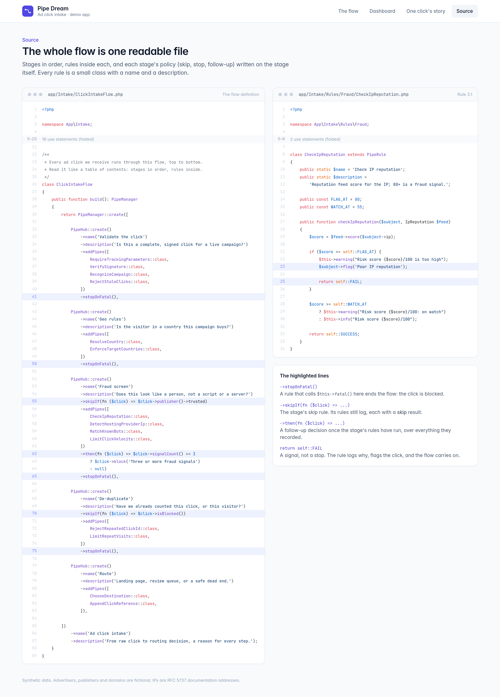

# Pipe Dream

Pipe Dream turns a Laravel pipeline into a flow you can read, and a log you can read back: every step named, timed and recorded.

```bash
composer require keaton-php/pipe-dream
```

The service provider is discovered automatically. At the end of this README, a full ad-click flow and the dashboard built from its logs show where this goes.

## What a pipeline is

A pipeline sends one value (the **subject**) through a list of steps (the **pipes**), in order. Each pipe gets the subject, does its bit, and passes it on. Laravel ships one, `Illuminate\Pipeline\Pipeline`, and the pipes can be plain closures:

<!-- example: docs/examples/scripts/pipeline.php -->
```php
<?php

use Illuminate\Pipeline\Pipeline;

$post = (object) ['title' => '  hello,   PIPE dream  '];

app(Pipeline::class)
    ->send($post)
    ->through([
        function ($post, $next) {
            $post->title = trim($post->title);

            return $next($post);
        },
        function ($post, $next) {
            $post->title = preg_replace('/\s+/', ' ', $post->title);

            return $next($post);
        },
        function ($post, $next) {
            $post->title = ucwords(strtolower($post->title));

            return $next($post);
        },
    ])
    ->thenReturn();

echo $post->title;
```

<!-- output: docs/examples/scripts/pipeline.php -->
```text
Hello, Pipe Dream
```

## The same thing as a PipeHub

A `PipeHub` is Pipe Dream's pipeline. The same three steps:

<!-- example: docs/examples/scripts/hub.php -->
```php
<?php

use Keaton\PipeDream\PipeHub;

$post = (object) ['title' => '  hello,   PIPE dream  '];

PipeHub::create()
    ->addPipes([
        fn ($post) => $post->title = trim($post->title),
        fn ($post) => $post->title = preg_replace('/\s+/', ' ', $post->title),
        fn ($post) => $post->title = ucwords(strtolower($post->title)),
    ])
    ->sendIt($post);

echo $post->title;
```

<!-- output: docs/examples/scripts/hub.php -->
```text
Hello, Pipe Dream
```

No `$next` to call and nothing to return: the hub moves on to the next pipe by itself.

## Why that's better

### The subject travels in an envelope

The hub wraps your subject in a `PipeEnvelope`, and that is what each pipe receives as its first parameter (and what `sendIt()` returns). Leave that parameter untyped, or type it `PipeEnvelope`. Reads, writes and method calls go straight through to your object:

<!-- example: docs/examples/scripts/envelope.php -->
```php
<?php

use Keaton\PipeDream\PipeHub;

$post = (object) ['title' => '  hello,   PIPE dream  '];

$envelope = PipeHub::create()
    ->addPipes([
        fn ($post) => $post->title = trim($post->title),
    ])
    ->sendIt($post);

echo get_class($envelope), PHP_EOL;
echo $envelope->title, PHP_EOL;                         // reads go straight to your object
echo $envelope->subject() === $post ? 'the same $post' : 'a copy', PHP_EOL;
```

<!-- output: docs/examples/scripts/envelope.php -->
```text
Keaton\PipeDream\PipeEnvelope
hello,   PIPE dream
the same $post
```

### Pipes can share values

The envelope also holds values of its own, for the pipes to pass along: `set()` one in a pipe, `get()` it in a later one. That makes small state machines easy:

<!-- example: docs/examples/scripts/state.php -->
```php
<?php

use Keaton\PipeDream\PipeHub;

$post = (object) ['title' => 'draft: Hello, Pipe Dream'];

$envelope = PipeHub::create()
    ->addPipes([
        function ($post) {
            $post->set('state', str_starts_with($post->title, 'draft:') ? 'draft' : 'ready');
        },
        function ($post) {
            if ($post->get('state') === 'draft') {
                $post->title = trim(substr($post->title, 6));
                $post->set('state', 'in review');
            }
        },
    ])
    ->sendIt($post);

echo $envelope->get('state'), ': ', $post->title;
```

<!-- output: docs/examples/scripts/state.php -->
```text
in review: Hello, Pipe Dream
```

### Every step is logged

Every pipe is timed, and what it returns is recorded. Here is the whole log of the hub from before:

<!-- example: docs/examples/scripts/log.php -->
```php
<?php

use Keaton\PipeDream\PipeHub;

$post = (object) ['title' => '  hello,   PIPE dream  '];

$envelope = PipeHub::create()
    ->addPipes([
        fn ($post) => $post->title = trim($post->title),
        fn ($post) => $post->title = preg_replace('/\s+/', ' ', $post->title),
        fn ($post) => $post->title = ucwords(strtolower($post->title)),
    ])
    ->sendIt($post);

foreach ($envelope->logs() as $record) {
    printf("%-11s %-19s %s\n", $record['type'], $record['key'], $record['data']);
}
```

<!-- output: docs/examples/scripts/log.php -->
```text
info        PipeHub:sendIt      Sending subject through all pipes
timerStart  Closure@log.php:9   Executing rule Closure@log.php:9
returnValue Closure@log.php:9   hello,   PIPE dream
timerEnd    Closure@log.php:9   Finished executing rule Closure@log.php:9
timerStart  Closure@log.php:10  Executing rule Closure@log.php:10
returnValue Closure@log.php:10  hello, PIPE dream
timerEnd    Closure@log.php:10  Finished executing rule Closure@log.php:10
timerStart  Closure@log.php:11  Executing rule Closure@log.php:11
returnValue Closure@log.php:11  Hello, Pipe Dream
timerEnd    Closure@log.php:11  Finished executing rule Closure@log.php:11
info        PipeHub:sendIt      Finalized result!
```

You can see each step's result without adding a single line of logging. `$envelope->results()` holds the same results, ready to check.

## Stack hubs into a PipeManager

A `PipeManager` runs several hubs in order, on the same envelope: one run, one log.

<!-- example: docs/examples/scripts/stack.php -->
```php
<?php

use Keaton\PipeDream\PipeHub;
use Keaton\PipeDream\PipeManager;

$post = (object) ['title' => '  hello,   PIPE dream  '];

$envelope = PipeManager::create([
    PipeHub::create()
        ->name('Tidy')
        ->addPipes([
            fn ($post) => $post->title = ucwords(strtolower(trim($post->title))),
            fn ($post) => $post->title = preg_replace('/\s+/', ' ', $post->title),
        ]),

    PipeHub::create()
        ->name('Slug')
        ->addPipes([
            fn ($post) => $post->slug = trim(preg_replace('/[^a-z0-9]+/', '-', strtolower($post->title)), '-'),
        ]),
])
    ->subject($post)
    ->sendIt();

echo $post->slug, PHP_EOL;
echo $envelope->results()->count(), ' results in one log of ', count($envelope->logs()), ' records', PHP_EOL;
```

<!-- output: docs/examples/scripts/stack.php -->
```text
hello-pipe-dream
3 results in one log of 15 records
```

## Rules: pipes as classes

A closure is fine for a small step. A `PipeRule` class gives a step a name, a home and a test. The hub runs the public method named after the class. Inside it, `$this->info('…')` writes a line to the log against the rule, and returning `self::SUCCESS` records that the step passed (the other results, and `$this->error()` / `$this->fatal()`, come in *Controlling the flow* below):

<!-- example: docs/examples/TidyTitle.php -->
```php
<?php

use Keaton\PipeDream\PipeRule;

class TidyTitle extends PipeRule
{
    public static $name = 'Tidy the title';
    public static $description = 'Trim it, collapse the spaces, title-case it';

    public function tidyTitle($post)
    {
        $post->title = ucwords(strtolower(preg_replace('/\s+/', ' ', trim($post->title))));

        $this->info("Title is now \"{$post->title}\"");

        return self::SUCCESS;
    }
}
```

The method is called through Laravel's container, so **dependency injection just works**: ask for a class and you get it. Here the rule asks for `Slugger`, a plain class of yours:

<!-- example: docs/examples/Slugger.php -->
```php
<?php

class Slugger
{
    public function slug(string $text): string
    {
        return trim(preg_replace('/[^a-z0-9]+/', '-', strtolower($text)), '-');
    }
}
```

And the rule that uses it:

<!-- example: docs/examples/SlugifyTitle.php -->
```php
<?php

use Keaton\PipeDream\PipeRule;

class SlugifyTitle extends PipeRule
{
    public static $name = 'Slugify the title';
    public static $description = 'Make the URL slug';

    public function slugifyTitle($post, Slugger $slugger)
    {
        $post->slug = $slugger->slug($post->title);

        return self::SUCCESS;
    }
}
```

The first parameter receives **the envelope**, whatever you call it (leave it untyped, or type it `PipeEnvelope`; a different class type there is resolved from the container instead). Inside a rule, `$this->words = 3` and `$this->words` set and read a shared value on it (`$this->setWordsResult(3)` and `$this->getWordsResult()` do the same):

<!-- example: docs/examples/CountWords.php -->
```php
<?php

use Keaton\PipeDream\PipeRule;

class CountWords extends PipeRule
{
    public static $name = 'Count the words';
    public static $description = 'Remember how long the title is';

    public function countWords($post)
    {
        $this->words = str_word_count($post->title);

        return self::SUCCESS;
    }
}
```

A rule can also decide that it has nothing to do and **skip** itself. For a one-word title, this one records `PipeRule::SKIP` (4) and logs its reason:

<!-- example: docs/examples/CheckTitleLength.php -->
```php
<?php

use Keaton\PipeDream\PipeRule;

class CheckTitleLength extends PipeRule
{
    public static $name = 'Check the title length';
    public static $description = 'Long titles get cut off in feeds';

    public function checkTitleLength($post)
    {
        if ($this->words < 2) {
            return $this->skip('A one-word title is fine');
        }

        if ($this->words > 12) {
            $this->error("The title has {$this->words} words");
        }

        return self::SUCCESS;
    }
}
```

Use them like closures, by class name:

<!-- example: docs/examples/scripts/rules.php -->
```php
<?php

use Keaton\PipeDream\PipeHub;

$post = (object) ['title' => '  hello,   PIPE dream  '];

$envelope = PipeHub::create()
    ->addPipes([
        TidyTitle::class,
        CountWords::class,
        CheckTitleLength::class,
        SlugifyTitle::class,
    ])
    ->sendIt($post);

echo $post->slug, ' (', $envelope->get('words'), ' words)', PHP_EOL;

foreach ($envelope->results() as $result) {
    echo $result->rule(), ': ', $result->result(), PHP_EOL;
}
```

<!-- output: docs/examples/scripts/rules.php -->
```text
hello-pipe-dream (3 words)
TidyTitle: 1
CountWords: 1
CheckTitleLength: 1
SlugifyTitle: 1
```

`1` is `PipeRule::SUCCESS`.

## All together

Name each hub, describe it, fill it with rules, stack the hubs in a manager, and send the post through. Closures and rules mix freely. `skipIf()` skips a hub's rules when it doesn't apply (each is logged as skipped), and `then()` runs after a hub's last rule:

<!-- example: docs/examples/scripts/together.php -->
```php
<?php

use Keaton\PipeDream\PipeHub;
use Keaton\PipeDream\PipeManager;

$post = (object) ['title' => '  hello,   PIPE dream  ', 'status' => 'ready'];

$envelope = PipeManager::create([
    PipeHub::create()
        ->name('Tidy')
        ->description('Make the title presentable')
        ->addPipes([TidyTitle::class]),

    PipeHub::create()
        ->name('Check')
        ->description('Is the title any good?')
        ->addPipes([CountWords::class, CheckTitleLength::class])
        ->then(fn ($post) => $post->readingTime = ceil($post->get('words') / 200).' min'),

    PipeHub::create()
        ->name('Publish')
        ->description('Give it a slug and publish it, unless it is a draft')
        ->skipIf(fn ($post) => $post->status === 'draft')
        ->addPipes([
            SlugifyTitle::class,
            fn ($post) => $post->status = 'published',
        ]),
])
    ->name('Publish a post')
    ->subject($post)
    ->sendIt();

foreach ($envelope->logs() as $record) {
    if ($record['data'] === 'Sending subject through all pipes') {
        echo $record['context']['name'], PHP_EOL;
    } elseif ($record['type'] === 'returnValue') {
        echo '  ', $record['key'], ': ', $record['data'], PHP_EOL;
    }
}

echo $post->status, ', ', $post->readingTime, ' read', PHP_EOL;
```

<!-- output: docs/examples/scripts/together.php -->
```text
Tidy
  TidyTitle: 1
Check
  CountWords: 1
  CheckTitleLength: 1
Publish
  SlugifyTitle: 1
  Closure@together.php:26: published
published, 1 min read
```

The flow reads like a table of contents, and the log tells the same story. With `'status' => 'draft'`, the Publish hub's pipes are logged as skipped instead, and the post stays a draft.

## Controlling the flow

A rule can stop things:

- `$this->error('why')` records a failure (`PipeRule::FAIL`) and, by default, the hub carries on (see `stopOnError()` in the Reference);
- `$this->fatal('why')` records a fatal (`PipeRule::FATAL_FAIL`) and ends the hub; give the hub `stopOnFatal()` and it ends the whole flow;
- throwing `PipeRuleRedirect` (`PipeRuleRedirect::toUrl($url)` or `::toRoute($name)`) or `PipeRuleLoadView` (`PipeRuleLoadView::load($view, $data)`) hands control back to your controller.

<!-- example: docs/examples/RejectEmptyTitle.php -->
```php
<?php

use Keaton\PipeDream\PipeRule;

class RejectEmptyTitle extends PipeRule
{
    public static $name = 'Reject empty titles';
    public static $description = 'A post needs a title';

    public function rejectEmptyTitle($post)
    {
        if (trim($post->title) === '') {
            $this->fatal('The post has no title');
        }

        return self::SUCCESS;
    }
}
```

<!-- example: docs/examples/SendDraftsToPreview.php -->
```php
<?php

use Keaton\PipeDream\Exceptions\PipeRuleRedirect;
use Keaton\PipeDream\PipeRule;

class SendDraftsToPreview extends PipeRule
{
    public static $name = 'Send drafts to the preview';
    public static $description = 'Drafts are previewed, not published';

    public function sendDraftsToPreview($post)
    {
        if ($post->status === 'draft') {
            PipeRuleRedirect::toUrl("/preview/{$post->id}");
        }

        return self::SUCCESS;
    }
}
```

A controller wraps the run in a `try`/`catch` for the redirects and views. A fatal is different: it never leaves `sendIt()` as an exception. It is recorded on the envelope, so you check for it afterwards:

<!-- example: docs/examples/PublishPost.php -->
```php
<?php

use Keaton\PipeDream\Exceptions\PipeRuleLoadView;
use Keaton\PipeDream\Exceptions\PipeRuleRedirect;
use Keaton\PipeDream\PipeHub;
use Keaton\PipeDream\PipeManager;

class PublishPost
{
    public function __invoke(object $post)
    {
        try {
            $envelope = PipeManager::create([
                PipeHub::create()
                    ->name('Check')
                    ->addPipes([RejectEmptyTitle::class, SendDraftsToPreview::class])
                    ->stopOnFatal(),

                PipeHub::create()
                    ->name('Publish')
                    ->addPipes([TidyTitle::class, SlugifyTitle::class]),
            ])
                ->name('Publish a post')
                ->subject($post)
                ->sendIt();
        } catch (PipeRuleRedirect $e) {
            return redirect($e->redirectTo);
        } catch (PipeRuleLoadView $e) {
            return view($e->view, $e->data);
        }

        // A fatal is not thrown: it is recorded on the envelope.
        if ($envelope->hasFatalErrors()) {
            return response()->json(['error' => 'This post cannot be published'], 422);
        }

        return redirect("/posts/{$post->slug}");
    }
}
```

<!-- example: docs/examples/scripts/controller.php -->
```php
<?php

$publish = app(PublishPost::class);

$posts = [
    (object) ['id' => 1, 'title' => '  hello,   PIPE dream  ', 'status' => 'ready'],
    (object) ['id' => 2, 'title' => '   ', 'status' => 'ready'],
    (object) ['id' => 3, 'title' => 'Work in progress', 'status' => 'draft'],
];

foreach ($posts as $post) {
    $response = $publish($post);

    echo $post->id, ': ', $response->getStatusCode(), ' ', $response->headers->get('Location') ?? $response->getContent(), PHP_EOL;
}
```

<!-- output: docs/examples/scripts/controller.php -->
```text
1: 302 http://localhost/posts/hello-pipe-dream
2: 422 {"error":"This post cannot be published"}
3: 302 http://localhost/preview/3
```

## Keeping the log

Publish and run the migration:

```bash
php artisan vendor:publish --tag=pipe-dream-migrations
php artisan migrate
```

Then give the envelope a `DatabasePersistStrategy`. Wrap the subject yourself with `PipeEnvelope::wrap()` to set things like this before the run:

<!-- example: docs/examples/scripts/database.php -->
```php
<?php

use Keaton\PipeDream\Models\PipeDreamLog;
use Keaton\PipeDream\PipeEnvelope;
use Keaton\PipeDream\PipeHub;
use Keaton\PipeDream\PipeManager;
use Keaton\PipeDream\Strategies\DatabasePersistStrategy;

$post = (object) ['title' => '  hello,   PIPE dream  '];

$envelope = PipeEnvelope::wrap($post)->persistWith(new DatabasePersistStrategy());

PipeManager::create([
    PipeHub::create()->name('Tidy')->addPipes([TidyTitle::class]),
    PipeHub::create()->name('Slug')->addPipes([SlugifyTitle::class]),
])->name('Publish a post')->subject($envelope)->sendIt();

PipeDreamLog::where('run_id', $envelope->runId())->count();   // 1
```

A manager saves once, when the flow ends, however it ended: one row per run, in `pipe_dream_logs`. Saving the same run again updates its row. Read a run back later, with every record intact:

<!-- example: docs/examples/scripts/rebuild.php -->
```php
<?php

use Keaton\PipeDream\Models\PipeDreamLog;

$run = PipeDreamLog::where('flow', 'Publish a post')->latest()->firstOrFail();

$run->has_fatals;                                                       // false
$run->logger()->infos()->firstWhere('key', TidyTitle::class)['data'];    // 'Title is now "Hello, Pipe Dream"'
```

## The payoff: a full ad-click flow

This is where it goes: one controller, eight hubs, one log per click. The hubs are the stages of a real click flow: validation and a session, tracking, geo exclusions, the advertiser's suppression list (skipped for newsletter-type campaigns), blacklists and graylists, bot checks (skipped when a campaign turns them off), caps and budget, and routing.

The subject is `IncomingClick`, a class of your own built from the request. It has fields (`id`, `campaign`, `country`, `ip`, `userAgent`, `publisher`, `email`) and a few methods the flow calls through the envelope: `campaignSettings()` (the campaign's countries, type and bot-check switch), `flag($reason)` / `isFlagged()`, `isListed()`, `isTest()`, `markComplete()` and `destination()`.

<!-- example: docs/examples/HandleAdClick.php -->
```php
<?php

use Illuminate\Http\Request;
use Keaton\PipeDream\Exceptions\PipeRuleLoadView;
use Keaton\PipeDream\Exceptions\PipeRuleRedirect;
use Keaton\PipeDream\PipeEnvelope;
use Keaton\PipeDream\PipeHub;
use Keaton\PipeDream\PipeManager;
use Keaton\PipeDream\Strategies\DatabasePersistStrategy;

class HandleAdClick
{
    public function __invoke(Request $request)
    {
        $click = PipeEnvelope::wrap(new IncomingClick($request))
            ->persistWith(new DatabasePersistStrategy());

        $started = microtime(true);

        try {
            PipeManager::create([

                PipeHub::create()
                    ->name('Validate & start session')
                    ->description('Is this a complete, signed click for a live campaign?')
                    ->addPipes([
                        RequireTrackingParameters::class,
                        VerifyClickSignature::class,
                        RecognizeCampaign::class,
                        StartClickSession::class,
                    ])
                    ->stopOnFatal(),             // a bad click ends the whole flow here

                PipeHub::create()
                    ->name('Tracking')
                    ->description('Attribution cookie and conversion-path tracking')
                    ->addPipes([
                        SetAttributionCookie::class,
                        RecordConversionPath::class,
                    ]),

                PipeHub::create()
                    ->name('Geo exclusions')
                    ->description('Is the visitor somewhere this campaign buys traffic?')
                    ->addPipes([
                        ResolveVisitorCountry::class,
                        EnforceCampaignCountries::class,
                        EnforceAdvertiserGeoExclusions::class,
                    ])
                    ->stopOnFatal(),

                PipeHub::create()
                    ->name('Suppression')
                    ->description('Has this visitor asked the advertiser not to contact them?')
                    ->addPipes([
                        CheckAdvertiserSuppressionList::class,
                    ])
                    ->skipIf(fn ($click) => $click->campaignSettings()->isNewsletter())
                    ->stopOnFatal(),

                PipeHub::create()
                    ->name('Blacklist & graylist')
                    ->description('Checks that are never skipped')
                    ->addPipes([
                        MatchIpBlacklist::class,
                        MatchPublisherBlacklist::class,
                        ChallengeGraylistedPublishers::class,
                    ])
                    ->then(fn ($click) => $click->isListed() ? $click->flag('Blacklisted') : null),

                PipeHub::create()
                    ->name('Bot checks')
                    ->description('Does this look like a person, not a script or a server?')
                    ->addPipes([
                        DetectHostingProviderIp::class,
                        MatchKnownBotUserAgents::class,
                        ScoreClickVelocity::class,
                    ])
                    ->skipIf(fn ($click) => $click->campaignSettings()->bot_checks_disabled)
                    ->then(fn ($click) => $click->get('bot_signals') >= 2 ? $click->flag('Two or more bot signals') : null),

                PipeHub::create()
                    ->name('Fulfillment & caps')
                    ->description('Daily caps and budget, only for clicks we will pay for')
                    ->addPipes([
                        EnforceDailyClickCap::class,
                        RecordBudgetSpend::class,
                    ])
                    ->skipIf(fn ($click) => $click->isFlagged() || $click->isTest()),

                PipeHub::create()
                    ->name('Route')
                    ->description('Landing page, review queue or a safe dead end')
                    ->addPipes([
                        ChooseDestination::class,
                    ]),

            ])
                ->name('Ad click intake')
                ->subject($click)
                ->persistLogs(false)             // we persist once, below, after the timer
                ->then(fn ($click) => $click->markComplete())
                ->sendIt();

        } catch (PipeRuleRedirect $e) {
            return redirect()->to($e->redirectTo);
        } catch (PipeRuleLoadView $e) {
            return view($e->view, $e->data);
        } finally {
            $click->logger()->info('Intake', sprintf('Handled in %.1f ms', (microtime(true) - $started) * 1000));
            $click->persist();                   // one row per click, whatever happened
        }

        return redirect()->to($click->destination());
    }
}
```

The controller saves the log once, in `finally`, after recording how long the click took (`->persistLogs(false)` stops the manager saving it first), so every click gets exactly one row, including the ones that end early or hand off to a view.

All of these rules are in `docs/examples/`. Some have real bodies (`CheckAdvertiserSuppressionList`, `ChallengeGraylistedPublishers`, `DetectHostingProviderIp`, `MatchKnownBotUserAgents`, `RecordBudgetSpend`, and the small ones the tests rely on: `RequireTrackingParameters`, `RecognizeCampaign`, `StartClickSession`, `ResolveVisitorCountry`, `EnforceCampaignCountries`, `MatchIpBlacklist`, `ChooseDestination`); the rest are placeholders that only return `SUCCESS`, named for what your own rule would do (`VerifyClickSignature`, `SetAttributionCookie`, `RecordConversionPath`, `EnforceAdvertiserGeoExclusions`, `MatchPublisherBlacklist`, `ScoreClickVelocity`, `EnforceDailyClickCap`).

### See it running

A demo app pushes 500 synthetic ad clicks through a five-stage, 14-rule flow like this one. Every page is built from the flow definition and the persisted logs, with nothing written by hand. The flow page is rendered from the code itself:



| Dashboard built from the logs | One click's full story | The whole flow is one readable file |
|---|---|---|
|  |  |  |

## Reference

### What a rule can return

| In the rule | Recorded | What happens next |
|---|---|---|
| `return self::SUCCESS;` (or return nothing) | `SUCCESS` (1) | the next pipe runs |
| `return self::FAIL;` | `FAIL` (2) | the next pipe runs; no error record is added |
| `return $this->skip('why');` | `SKIP` (4), and the reason | the next pipe runs |
| `$this->error('why');` | `FAIL` (2), and an error record | the next pipe runs |
| `$this->fatal('why');` | `FATAL_FAIL` (3), and a fatal record | the rest of this hub is skipped |
| any other exception or PHP error, except the three below | `FAIL` (2), and an error record | the next pipe runs |

A closure pipe's result is whatever it returns (nothing, or the subject itself, counts as `SUCCESS`). `error()` and `fatal()` records point at the line in your rule that called them. Three exceptions are not failures and are never recorded as `FAIL`: `PipeRuleRedirect` and `PipeRuleLoadView` hand control back to your controller, and `PipeHubException`, a configuration error, is thrown straight out of the flow.

### Stopping, in one table

| On the hub | A rule calls `fatal()` | A rule calls `error()` | An exception escapes a rule |
|---|---|---|---|
| (default) | the hub ends: its remaining rules and `then()` are skipped, the next hub runs | logged as `FAIL`, the hub carries on | the hub ends as a failure, `onFailure()` runs, the next hub runs |
| `->stopOnFatal()` | **the whole flow ends**: no later hub, and the manager's `then()` does not run | as default | as default |
| `->stopOnError()` | as default | the hub ends as a failure, `onFailure()` runs, the next hub runs | as default |
| `->failureIsFatal()` | as default | as default (or the flow ends, with `stopOnError()`) | `onFailure()` runs, a fatal is logged and **the whole flow ends** |

"Exception" means any `Throwable`, PHP errors such as `TypeError` included. For unexpected exceptions, only `withoutErrorHandling()` (called inside the rule) or `protected $rethrowErrors = true` on the rule lets one escape it; otherwise it is logged as a `FAIL` and the hub carries on. Fatals, errors under `stopOnError()`, redirects, views and configuration errors leave a rule by design. `onFailure(fn ($subject, $exception) => …)` receives the exception as `$exception`. A fatal never leaves `sendIt()`: it is recorded on the envelope (`hasFatalErrors()`), and `sendIt()` returns the envelope as usual. A manager's `then()` runs after its last hub, unless the flow ended early.

### Skipping, in one table

| | What runs | What is logged | `then()` |
|---|---|---|---|
| `->skipIf(fn ($s) => …)` returns true | no rule executes | every rule, as `SKIP` with the reason (plus a `PipeHub:event` line when a skip event is set) | runs |
| `->skip()` | nothing in the hub | one "Skipping hub" line (plus a `PipeHub:event` line when a skip event is set) | does not run |
| `$envelope->skipAll()` (from a rule or callback) | nothing after that point, in this hub or any later hub | every remaining rule, as `SKIP` | runs |
| a rule returns `$this->skip('…')` | the rule ran and decided to skip | that rule, as `SKIP` with the reason | runs |

### Rule options

- `public static $runFunction = 'check';` runs a method with another name.
- `public static $saveResultAs = 'title_verdict';` also stores the rule's result under that key.
- `protected $errorsAreFatal = true;` turns the rule's `error()` calls into fatals.
- `$this->foo = $value` / `$this->foo`, and `$this->setFooResult($value)` / `$this->getFooResult()`, write and read `foo` on the envelope while the rule runs.
- Rule results are stored on the envelope under the class name: `$envelope->get(TidyTitle::class)`.
- `addPipe()` and `addPipes()` throw a `PipeHubException` for a class that does not exist or is not a `PipeRule`, so a typo never quietly drops a step.

### Reading the log

Every record is an array with a `time`, a `key` (the rule class, a closure's file and line, or `PipeHub:sendIt` / `PipeManager:sendIt`), a `type` (`info`, `warning`, `error`, `fatal`, `timerStart`, `timerEnd`, `returnValue`), its `data` and a `context` array (a hub's start and skip records carry its name and description). The logger has slices for the common questions: `errors()`, `fatals()`, `warnings()`, `timers()`, `returnValues()` and `recordsByKey($key)`; `$envelope->hasErrors()` and `$envelope->hasFatalErrors()` answer the most common ones, and `$envelope->results()` has `successes()`, `failures()`, `fatalFailures()` and `skips()`. Add your own lines with `$envelope->logger()->info($key, $message)`. Every envelope has a `runId()`, a uuid that identifies the run.

### Log levels

`$envelope->logLevel(PipeLogger::LEVEL_EVERYTHING)` is the default; `LEVEL_NO_TIMERS` drops the rule timers; `LEVEL_PROBLEMS` keeps only warnings, errors and fatals. Records below the level are never written. Results are recorded whatever the level.

### Events

A hub can dispatch Laravel events at five points. Hub events are constructed with the envelope; per-rule events with the envelope and the rule's key. Declare the event classes:

<!-- example: docs/examples/BotCheckEvents.php -->
```php
<?php

use Keaton\PipeDream\PipeEnvelope;

class BotChecksStarted
{
    public function __construct(public PipeEnvelope $click) {}
}

class BotChecksFinished
{
    public function __construct(public PipeEnvelope $click) {}
}

class BotChecksSkipped
{
    public function __construct(public PipeEnvelope $click) {}
}

class RuleStarting
{
    public function __construct(public PipeEnvelope $click, public ?string $rule = null) {}
}

class RuleFinished
{
    public function __construct(public PipeEnvelope $click, public ?string $rule = null) {}
}
```

Then name them on the hub:

<!-- example: docs/examples/scripts/events.php -->
```php
<?php

use Illuminate\Support\Facades\Event;
use Keaton\PipeDream\PipeHub;

$fired = [];

Event::listen(
    [BotChecksStarted::class, BotChecksFinished::class, BotChecksSkipped::class, RuleStarting::class, RuleFinished::class],
    function ($event) use (&$fired) {
        $fired[] = class_basename($event).(isset($event->rule) ? '('.class_basename($event->rule).')' : '');
    }
);

PipeHub::create()
    ->name('Bot checks')
    ->addPipes([DetectHostingProviderIp::class, MatchKnownBotUserAgents::class])
    ->broadcastEventBefore(BotChecksStarted::class)          // before the first rule
    ->broadcastEventAfter(BotChecksFinished::class)          // after the last rule, before then()
    ->broadcastEventOnSkip(BotChecksSkipped::class)          // instead of both, when the hub is skipped
    ->broadcastEventBeforeEachPipe(RuleStarting::class)      // just before each rule runs
    ->broadcastEventAfterEachPipe(RuleFinished::class)       // as each rule hands off to the next
    ->sendIt((object) ['id' => 'clk_134', 'ip' => '203.0.113.9', 'userAgent' => 'Mozilla/5.0']);

implode(', ', $fired);   // 'BotChecksStarted, RuleStarting(DetectHostingProviderIp), RuleFinished(DetectHostingProviderIp), RuleStarting(MatchKnownBotUserAgents), RuleFinished(MatchKnownBotUserAgents), BotChecksFinished'
```

`before` and `after` bracket the rules, `beforeEach`/`afterEach` surround each rule in turn, and a skipped hub dispatches only the skip event. A rule that stops the hub never hands off, so its `afterEach` does not fire; skipped rules fire neither. Every dispatch is written to the log under `PipeHub:event`.

### Rule copies: shared and transient bindings

Each run resolves the rule from the container. An ordinary (transient) binding runs exactly as the container returned it. A rule bound as shared (`singleton()`, `instance()`, `scoped()`, or the container's `#[Singleton]`/`#[Scoped]` attributes on Laravel versions that have them) runs as a clone, so the shared object is never executed and the rule's own scalar settings never carry from one run to the next. PHP clones are shallow: an object held in a property of a shared rule is still shared, so give the rule a `__clone()` that copies it if each run needs its own. A shared rule that cannot be cloned (a private `__clone()`, or one that throws) is a configuration error: the flow throws a `PipeHubException` telling you to bind it non-shared, rather than silently skipping the rule. Keep anything that must outlive a run in an injected service. A hub given its own container (`PipeHub::create($container)`) runs its rules, callbacks and events in that container. An envelope you created yourself and passed in keeps the container it was created with for its own services, such as a persistence strategy bound in the container.

### JSON-safe log values

Every value is made JSON-safe as it is recorded, so a value a rule returned can never make the log fail to encode and hide what the flow did. (Saving can still fail for ordinary reasons such as the database being down; those errors are not swallowed.) A rule may return anything, but `NAN` and `INF` are logged as the strings `"NAN"` / `"INF"`, resources as `"resource(stream)"`, closures as `"Closure"`, backed enums as their value and unit (pure) enums as their name, dates as ISO 8601 strings, exceptions as their class and message, other objects as their public properties plus a `__class` key (or what their `jsonSerialize()`, `toArray()` or `__toString()` gives), cycles as `"[recursion: Class]"`, nesting past 16 levels as `"[max depth]"`, and invalid UTF-8 bytes are replaced. The raw value is still what `$envelope->get(Rule::class)` and `$envelope->results()` return.

### Saving logs

Once a persistence strategy is set up, a manager saves the log once, when the flow ends, whether it completed, stopped early or threw; a hub run on its own saves when it finishes. `->persistLogs(false)` turns that off, so you can call `$envelope->persist()` yourself. A run is saved with the strategy given to `$envelope->persistWith()`, else the one bound to `PipeLoggerPersistStrategy` in the container (bind `DatabasePersistStrategy` there once to use it for every flow); with neither, nothing is written.

The `pipe_dream_logs` row holds the run id, the flow's name, the log (JSON), `has_errors` / `has_fatals`, and the subject's type and id when the subject is a saved Eloquent model. It is written with a single upsert keyed on the run id. The query scopes `PipeDreamLog::forRun($runId)->first()` (one run) and `PipeDreamLog::withProblems()->get()` (runs with errors or fatals) find runs, and `logger()` rebuilds a run's records. `new DatabasePersistStrategy(new PipeLoggerSerializeStrategy())` stores PHP `serialize()` output instead of JSON (rebuilt with `allowed_classes => false`, so a stored log can never instantiate objects); pass the same strategy to `logger()` to read it back. To store logs somewhere else, implement `PipeLoggerPersistStrategy`, which has one method, `persist(PipeEnvelope $subject)`; `$subject->logger()->output()` gives you the log as JSON.

### Introspecting a flow

Tools can read a flow back without reflection, which is how the demo renders its flow page from the same objects that process the clicks: `PipeManager::getName()`, `getDescription()`, `getHubs()`; `PipeHub::getName()`, `getDescription()`, `getPipes()`, `getSkipIf()`, `getThen()`, `getOnFailure()`, `getEvents()`, `stopsOnFatal()`, `stopsOnError()`, `isFailureFatal()`, `isSkipped()`.

### Compatibility

Tested on Laravel 9–13 (CI matrix) with PHP 8.1–8.4, each Laravel major on the PHP versions it supports: Laravel 9 on 8.1–8.2, 10 on 8.1–8.3, 11 and 12 on 8.2–8.4, 13 on 8.3–8.4.

### Testing

```bash
composer install
composer test
```

The suite uses Orchestra Testbench, and its database tests run on in-memory SQLite. Every PHP block in this README is a complete file in `docs/examples/`, shown exactly as it is; `tests/Feature/ReadmeExamplesTest.php` runs each script and loads each class just as shown, checks every output shown and every `// value` comment.

### Changelog and license

See [CHANGELOG.md](CHANGELOG.md) for what changed. MIT licensed; see [LICENSE](LICENSE).
