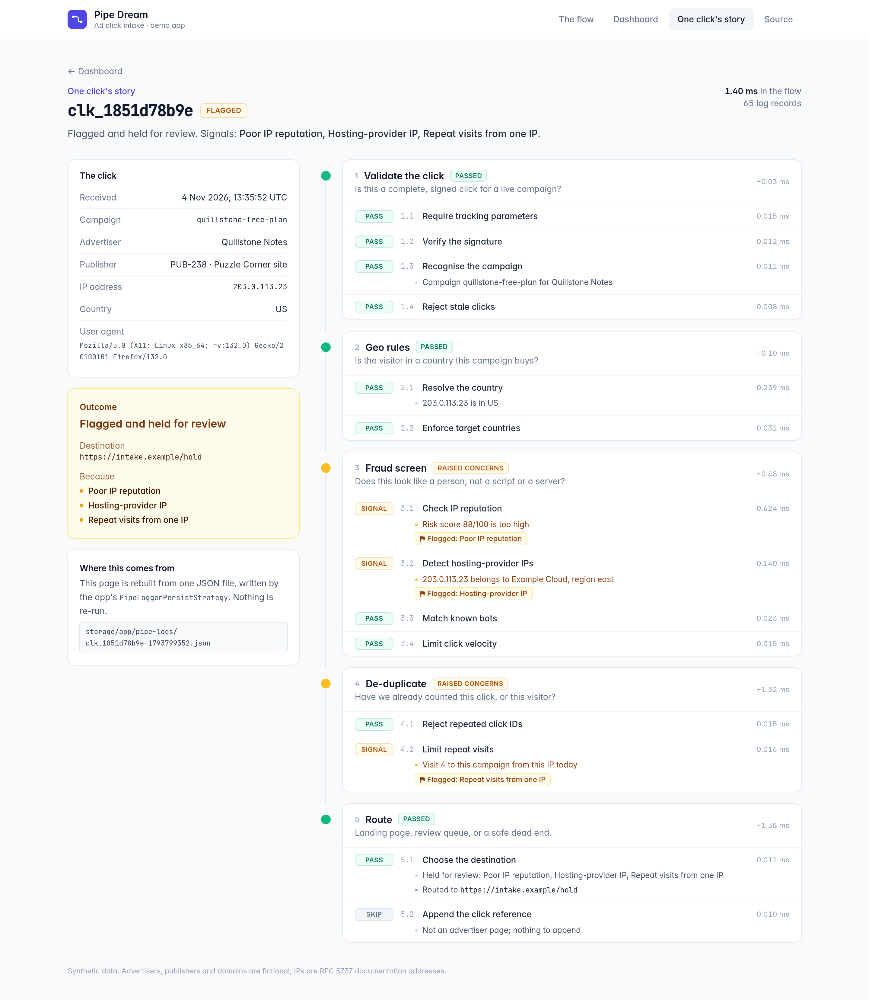

<!-- nav-group: In production -->
# Saving and replaying runs

Save each run, and the receipt of any click or order can be pulled back later. The answer to "why was this order held?" is then one query.

## Turn it on

Run the migration from [Installation](02-installation.md), then bind the database strategy once, in a service provider. From then on every flow saves itself, one row per run:

```php
use Keaton\PipeDream\Contracts\PipeLoggerPersistStrategy;
use Keaton\PipeDream\Models\PipeDreamLog;
use Keaton\PipeDream\Strategies\DatabasePersistStrategy;

// Once, in a service provider:
app()->bind(PipeLoggerPersistStrategy::class, DatabasePersistStrategy::class);

$runId = CheckoutFlow::build()
    ->subject(Orders::find('ord_48213'))
    ->sendIt()
    ->runId();

// Later, from a support ticket:
echo PipeDreamLog::forRun($runId)->first()->receipt();
```

```text
Checkout · On hold: Two or more fraud signals (0.26 ms)

Validate the order: Is this a complete order for items we can actually ship?
  ✓ RequireShippingAddress        (0.02 ms)
  ✓ ConfirmItemsInStock           (0.02 ms)  3 items in stock
  ✓ ApplyDiscountCodes            (0.01 ms)  SPRING20 applied: -$24.00
  ✓ CalculateTax                  (0.01 ms)  Tax: $7.92

Fraud screen: Does this look like the real cardholder?
  ✗ MatchBillingToShippingCountry (0.01 ms)  Billing US, shipping NL
  ✗ CheckCardVelocity             (0.01 ms)  4 cards tried on this account in 10 minutes
  ✓ ScoreDeviceFingerprint        (0.01 ms)

Charge: Take the money, only for orders we will ship · skipped: Order is on hold
  ↷ AuthorizePayment              skipped
  ↷ CapturePayment                skipped

Fulfill: Reserve stock, tell the warehouse, email the receipt · skipped: Order is on hold
  ↷ ReserveInventory              skipped
  ↷ SendToWarehouse               skipped
  ↷ EmailReceipt                  skipped
```

The saved receipt has the same steps, the same notes and the same "On hold" header as the one the run printed.

## When it saves

A flow saves once, when it ends, however it ended: completed, stopped or thrown. A hub run alone saves when it finishes. Saving the same run again updates its row.

To save one run only, wrap the subject yourself: `PipeEnvelope::wrap($order)->persistWith(new DatabasePersistStrategy)`. To save by hand, call `->persistLogs(false)` on the flow and `$envelope->persist()` when you are ready. The [click intake](11-click-intake.md) does both.

## Find runs

`PipeDreamLog` is an ordinary Eloquent model:

| You want | Ask |
|---|---|
| one run | `PipeDreamLog::forRun($runId)->first()` |
| every run with an error or a fatal | `PipeDreamLog::withProblems()->get()` |
| the runs of one flow | `PipeDreamLog::where('flow', 'Checkout')` |
| the model a run was about | `$run->subject`, when the subject was a saved Eloquent model |
| its receipt | `$run->receipt()` |

Each row has the run id, the flow's name, the log, `has_errors`, `has_fatals`, and the subject's type and id.

## Every run is a row, so dashboards are easy

A run is saved as one row with a simple shape: the flow's name, the subject's type and id, `has_errors`, `has_fatals`, and the log, which holds every step with how long it took. That makes the numbers people ask for into ordinary queries. How many clicks were dropped today, which rule dropped them, which stage is slow: each is a `where` and a count, and the receipt of any row is one call away.

As an example, this page was built from one saved click, and nothing else:



## Where it is written, and how

There are two separate choices. A persist strategy decides where the log goes:

| Where | Choose it when |
|---|---|
| `DatabasePersistStrategy` | you want to query past runs. This is the usual choice. |
| your own `PipeLoggerPersistStrategy` | the log belongs in a file, a log service or a queue. `persist(PipeEnvelope $envelope)` gets the envelope, and `$envelope->logger()->output()` is the log as JSON. |
| none, the default | you only need the receipt during the request, or in a test. |

A log strategy decides how the log is encoded:

| How | Choose it when |
|---|---|
| `PipeLoggerJsonStrategy`, the default | almost every time. |
| `PipeLoggerSerializeStrategy` | you want PHP's `serialize()` form. Read it back with the same strategy: `$run->receipt(new PipeLoggerSerializeStrategy)`. |

Every value is made JSON-safe as it is recorded, including objects, enums, dates, `NAN` and cycles. An odd return value therefore does not stop a run from being saved.

**Next:** [Testing flows](10-testing.md).
