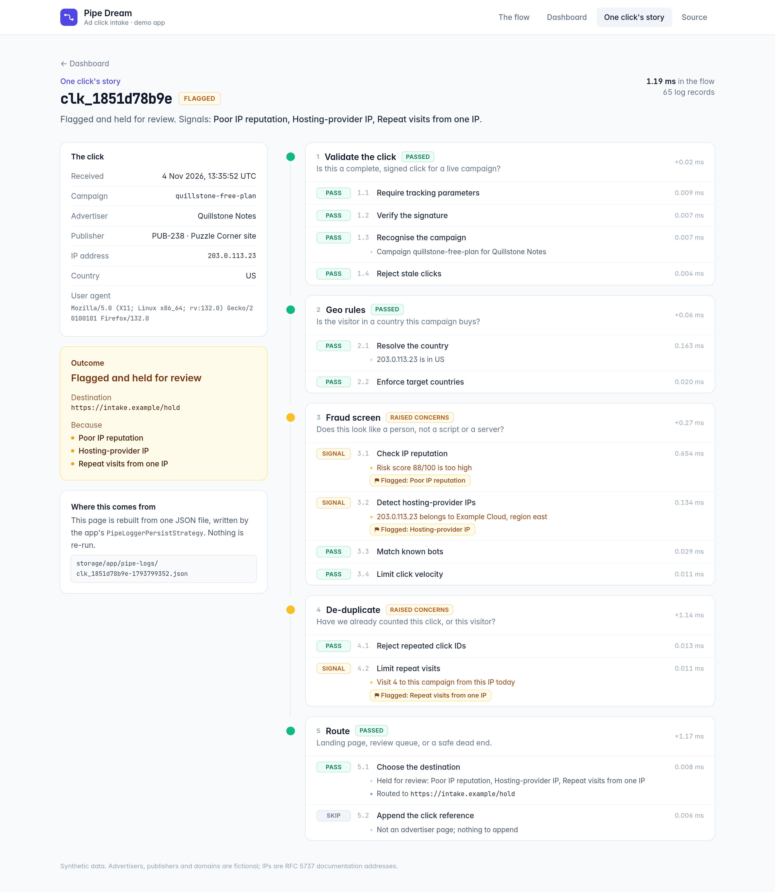

<!-- nav-group: Keeping and reading logs -->
# Reading a saved run

How do I get a saved run back, with every record intact?

## Rebuild a run from its row

`PipeDreamLog` is an ordinary Eloquent model. After the run saved on [the previous page](13-persisting.md), read it back later, with every record intact. Its `logger()` rebuilds the stored records, and `has_fatals` and `has_errors` tell you at a glance how the run went:

<!-- example: docs/examples/scripts/rebuild.php -->
```php
<?php

use Keaton\PipeDream\Models\PipeDreamLog;

$run = PipeDreamLog::where('flow', 'Publish a post')->latest()->firstOrFail();

$run->has_fatals;                                                       // false
$run->logger()->infos()->firstWhere('key', TidyTitle::class)['data'];    // 'Title is now "Hello, Pipe Dream"'
```

## Find runs

Two query scopes find runs:

- `PipeDreamLog::forRun($runId)->first()` returns one run.
- `PipeDreamLog::withProblems()->get()` returns the runs that have errors or fatals.

The model also has a `subject()` relation, filled in when the subject was a saved Eloquent model, so you can load the model a run belongs to.

## See the whole path

Here's what all that saved information lets you do: pull any single click back whole and see its entire path through the pipeline, stage by stage:



*One real click, replayed from the log: every stage, every pass, skip and flag, long after it happened.*

Next: [Choosing a persist strategy](15-persist-strategies.md).
