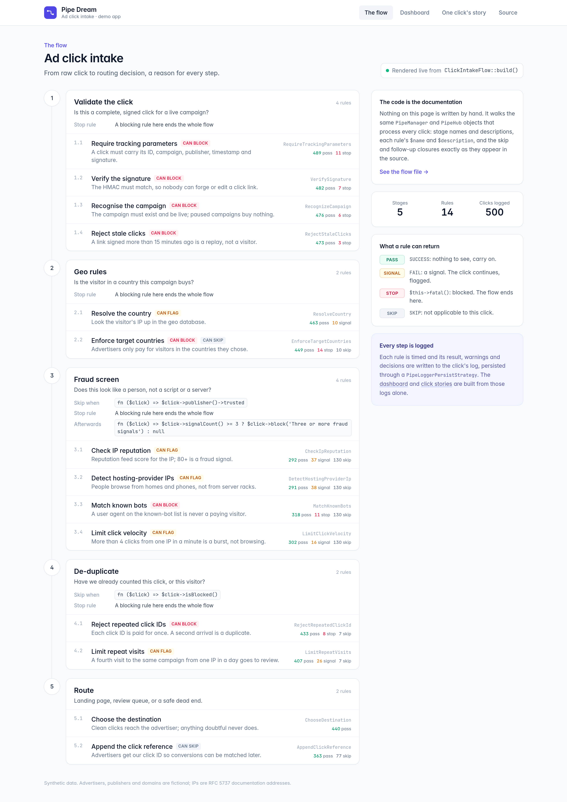
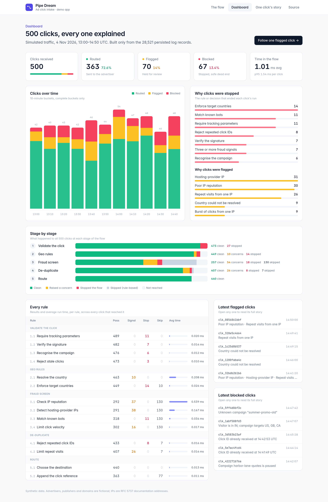

<!-- nav-group: In production -->
# Drawing your flow

A flow can be read back without running it, so a page that documents or draws it is built from the same objects that run in production, and never goes out of date.

## Read it back

<!-- example: docs/examples/scripts/drawing.php -->
```php
<?php

$flow = CheckoutFlow::build();

echo $flow->getName(), PHP_EOL;

echo collect($flow->getHubs())
    ->map(fn ($hub) => sprintf(
        "  %s: %s (%d rules%s)",
        $hub->getName(),
        $hub->getDescription(),
        count($hub->getPipes()),
        $hub->getSkipIf() ? ', can be skipped' : '',
    ))
    ->implode(PHP_EOL);
```

<!-- output: docs/examples/scripts/drawing.php -->
```text
Checkout
  Validate the order: Is this a complete order for items we can actually ship? (4 rules)
  Fraud screen: Does this look like the real cardholder? (3 rules, can be skipped)
  Charge: Take the money, only for orders we will ship (2 rules, can be skipped)
  Fulfil: Reserve stock, tell the warehouse, email the receipt (3 rules, can be skipped)
```

## What you can read

- **`PipeManager`:** `getName()`, `getDescription()`, `getHubs()`, `getThen()`, `getOnError()`, `getOnFatal()`, `throwsFatals()`, `persistsLogs()`.
- **`PipeHub`:** `getName()`, `getDescription()`, `getPipes()`, `getSkipIf()`, `getSkipIfReason()`, `getThen()`, `getOnError()`, `getOnFatal()`, `getEvents()`, `stopsOnlyThisHubOnFatal()`, `treatsErrorsAsFatal()`, `isSkipped()`, `throwsFatals()`, `persistsLogs()`.
- **A rule class:** `$name` and `$description`, as static properties.

## What it looks like

The click-intake demo renders its flow page from the flow definition, and its dashboard from saved runs, with nothing written by hand:





**Next:** [A full checkout](16-checkout-walkthrough.md).
