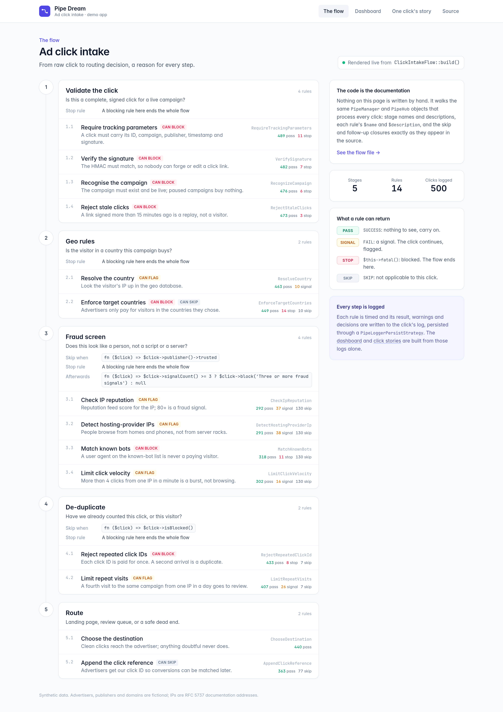
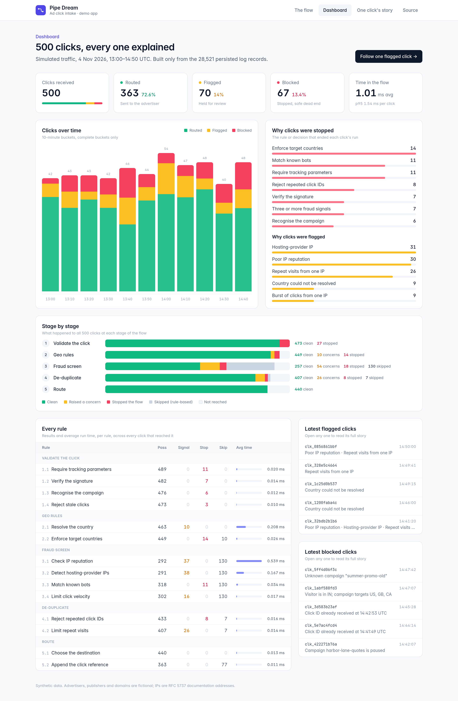

<!-- nav-group: Advanced -->
# Introspecting a flow

How do I read a flow back, to draw it or document it?

Tools can read a flow back without reflection. That is how the demo app renders its flow page from the same objects that process the clicks.

## List a flow's hubs

<!-- example: docs/examples/scripts/introspect.php -->
```php
<?php

use Keaton\PipeDream\PipeHub;
use Keaton\PipeDream\PipeManager;

$flow = PipeManager::create([
    PipeHub::create()
        ->name('Tidy')
        ->description('Make the title presentable')
        ->addPipes([TidyTitle::class, CountWords::class]),

    PipeHub::create()
        ->name('Publish')
        ->description('Give it a slug')
        ->addPipes([SlugifyTitle::class])
        ->fatalsStopThisHubOnly(),
])->name('Publish a post');

echo $flow->getName(), PHP_EOL;

foreach ($flow->getHubs() as $hub) {
    echo '- ', $hub->getName(), ': ', $hub->getDescription(), ' (pipes: ', count($hub->getPipes()), ')';
    echo $hub->stopsOnlyThisHubOnFatal() ? ', fatals stop only this hub' : '', PHP_EOL;
}
```

<!-- output: docs/examples/scripts/introspect.php -->
```text
Publish a post
- Tidy: Make the title presentable (pipes: 2)
- Publish: Give it a slug (pipes: 1), fatals stop only this hub
```

## What you can read

- **`PipeManager`:** `getName()`, `getDescription()`, `getHubs()`, `getThen()`, `getOnError()`, `getOnFatal()`, `throwsFatals()`, `persistsLogs()`.
- **`PipeHub`:** `getName()`, `getDescription()`, `getPipes()`, `getSkipIf()`, `getThen()`, `getOnError()`, `getOnFatal()`, `getEvents()`, `stopsOnlyThisHubOnFatal()`, `treatsErrorsAsFatal()`, `isSkipped()`, `throwsFatals()`, `persistsLogs()`.

## Drawing it

A demo app pushes 500 synthetic ad clicks through a five-stage, 14-rule flow. Every page is built from the flow definition and the persisted logs, with nothing written by hand. The flow page is rendered from the code itself:



And the dashboard is built from the saved logs:



Next: [Testing your flows](18-testing.md).
