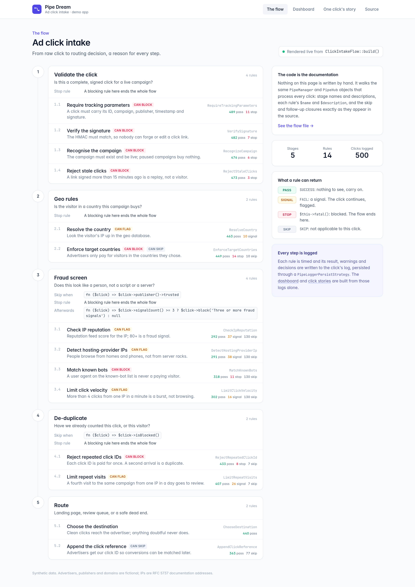
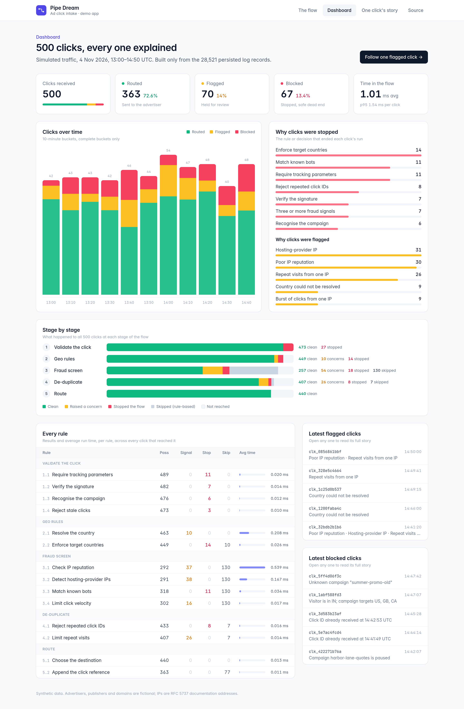
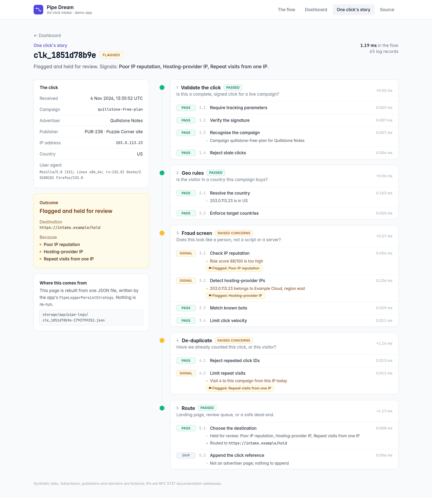
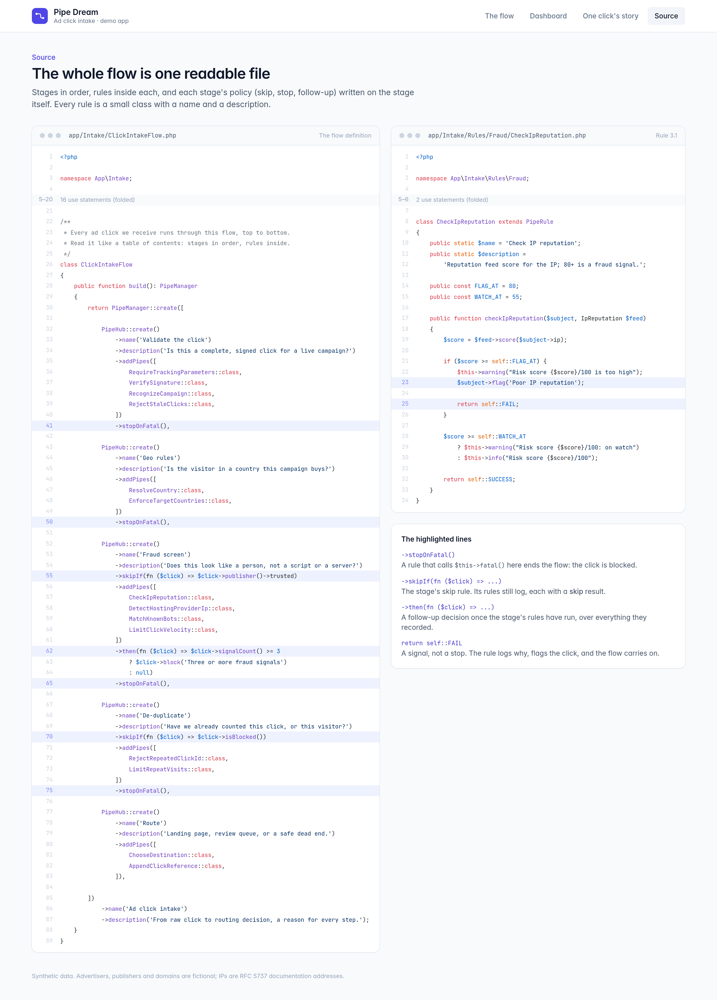

<!-- nav-group: Walkthrough -->
# A full click flow

What does a real flow look like: eight hubs, one log per click, a dashboard built from the logs?

## From a post title to a click

Everything so far tidied one post title. The same four ideas run a real ad-click flow, only bigger: **rules** are the checks, **hubs** are the stages, a **manager** stacks the stages into one flow, and a saved **log** records every click. Where the post-title flow had three hubs, this one has eight, one controller and one log per click.

## The subject

The subject is `IncomingClick`, a class of your own built from the request. It has fields (`id`, `campaign`, `country`, `ip`, `userAgent`, `publisher`, `email`) and a few methods the flow calls through the envelope: `campaignSettings()` (the campaign's countries, type and bot-check switch), `flag($reason)` / `isFlagged()`, `isListed()`, `isTest()`, `markComplete()` and `destination()`.

## The flow

<!-- example: docs/examples/HandleAdClick.php -->
```php
<?php

use Illuminate\Http\Request;
use Keaton\PipeDream\Exceptions\PipeRuleLoadView;
use Keaton\PipeDream\Exceptions\PipeRuleRedirect;
use Keaton\PipeDream\PipeEnvelope;
use Keaton\PipeDream\PipeHub;
use Keaton\PipeDream\PipeManager;
use Keaton\PipeDream\Strategies\DatabasePersistStrategy;

class HandleAdClick
{
    public function __invoke(Request $request)
    {
        $click = PipeEnvelope::wrap(new IncomingClick($request))
            ->persistWith(new DatabasePersistStrategy());

        $started = microtime(true);

        try {
            PipeManager::create([

                PipeHub::create()
                    ->name('Validate & start session')
                    ->description('Is this a complete, signed click for a live campaign?')
                    ->addPipes([
                        RequireTrackingParameters::class,
                        VerifyClickSignature::class,
                        RecognizeCampaign::class,
                        StartClickSession::class,
                    ]),                          // a fatal here (a bad click) ends the whole flow

                PipeHub::create()
                    ->name('Tracking')
                    ->description('Attribution cookie and conversion-path tracking')
                    ->addPipes([
                        SetAttributionCookie::class,
                        RecordConversionPath::class,
                    ]),

                PipeHub::create()
                    ->name('Geo exclusions')
                    ->description('Is the visitor somewhere this campaign buys traffic?')
                    ->addPipes([
                        ResolveVisitorCountry::class,
                        EnforceCampaignCountries::class,
                        EnforceAdvertiserGeoExclusions::class,
                    ]),

                PipeHub::create()
                    ->name('Suppression')
                    ->description('Has this visitor asked the advertiser not to contact them?')
                    ->addPipes([
                        CheckAdvertiserSuppressionList::class,
                    ])
                    ->skipIf(fn ($click) => $click->campaignSettings()->isNewsletter()),

                PipeHub::create()
                    ->name('Blacklist & graylist')
                    ->description('Checks that are never skipped')
                    ->addPipes([
                        MatchIpBlacklist::class,
                        MatchPublisherBlacklist::class,
                        ChallengeGraylistedPublishers::class,
                    ])
                    ->then(fn ($click) => $click->isListed() ? $click->flag('Blacklisted') : null),

                PipeHub::create()
                    ->name('Bot checks')
                    ->description('Does this look like a person, not a script or a server?')
                    ->addPipes([
                        DetectHostingProviderIp::class,
                        MatchKnownBotUserAgents::class,
                        ScoreClickVelocity::class,
                    ])
                    ->skipIf(fn ($click) => $click->campaignSettings()->bot_checks_disabled)
                    ->then(fn ($click) => $click->get('bot_signals') >= 2 ? $click->flag('Two or more bot signals') : null),

                PipeHub::create()
                    ->name('Fulfillment & caps')
                    ->description('Daily caps and budget, only for clicks we will pay for')
                    ->addPipes([
                        EnforceDailyClickCap::class,
                        RecordBudgetSpend::class,
                    ])
                    ->skipIf(fn ($click) => $click->isFlagged() || $click->isTest())
                    ->errorsAreFatal()           // a failed charge ends this hub...
                    ->fatalsStopThisHubOnly(),   // ...but the click is still routed

                PipeHub::create()
                    ->name('Route')
                    ->description('Landing page, review queue or a safe dead end')
                    ->addPipes([
                        ChooseDestination::class,
                    ]),

            ])
                ->name('Ad click intake')
                ->subject($click)
                ->persistLogs(false)             // we persist once, below, after the timer
                ->then(fn ($click) => $click->markComplete())
                ->sendIt();

        } catch (PipeRuleRedirect $e) {
            return redirect()->to($e->redirectTo);
        } catch (PipeRuleLoadView $e) {
            return view($e->view, $e->data);
        } finally {
            $click->logger()->info('Intake', sprintf('Handled in %.1f ms', (microtime(true) - $started) * 1000));
            $click->persist();                   // one row per click, whatever happened
        }

        return redirect()->to($click->destination());
    }
}
```

A fatal in any hub ends the click's flow, except in *Fulfillment & caps*: there `errorsAreFatal()` turns a failed charge into a fatal, and `fatalsStopThisHubOnly()` contains it to that hub, so the click is still routed.

The controller saves the log once, in `finally`, after recording how long the click took (`->persistLogs(false)` stops the manager saving it first), so every click gets exactly one row, including the ones that end early or hand off to a view.

## Stage by stage

### Stage 1: validate and start a session

Is this a complete, signed click for a live campaign? A fatal here (a bad click) ends the whole flow.

### Stage 2: tracking

The attribution cookie and conversion-path tracking.

### Stage 3: geo exclusions

Is the visitor somewhere this campaign buys traffic? The campaign's countries and the advertiser's own exclusions are both enforced.

### Stage 4: suppression

Has this visitor asked the advertiser not to contact them? This hub is skipped for newsletter-type campaigns (`skipIf()`).

### Stage 5: blacklists and graylists

Checks that are never skipped. The hub's `then()` flags a click from a listed address or publisher.

### Stage 6: bot checks

Does this look like a person, not a script or a server? Skipped when a campaign turns bot checks off; two or more signals flag the click.

### Stage 7: fulfillment and caps

Daily caps and budget, only for clicks we will pay for: skipped when the click is flagged or a test.

### Stage 8: route

Landing page, review queue or a safe dead end.

## The rules in this walkthrough

All of these rules are in `docs/examples/`. Some have real bodies (`CheckAdvertiserSuppressionList`, `ChallengeGraylistedPublishers`, `DetectHostingProviderIp`, `MatchKnownBotUserAgents`, `RecordBudgetSpend`, and the small ones the tests rely on: `RequireTrackingParameters`, `RecognizeCampaign`, `StartClickSession`, `ResolveVisitorCountry`, `EnforceCampaignCountries`, `MatchIpBlacklist`, `ChooseDestination`); the rest are placeholders that only return `SUCCESS`, named for what your own rule would do (`VerifyClickSignature`, `SetAttributionCookie`, `RecordConversionPath`, `EnforceAdvertiserGeoExclusions`, `MatchPublisherBlacklist`, `ScoreClickVelocity`, `EnforceDailyClickCap`).

## See it running

A demo app pushes 500 synthetic ad clicks through a five-stage, 14-rule flow like this one. Every page is built from the flow definition and the persisted logs, with nothing written by hand. The flow page is rendered from the code itself:



| Dashboard built from the logs | One click's full story | The whole flow is one readable file |
|---|---|---|
|  |  |  |

Next: [Return values and stop tables](20-reference-tables.md).
