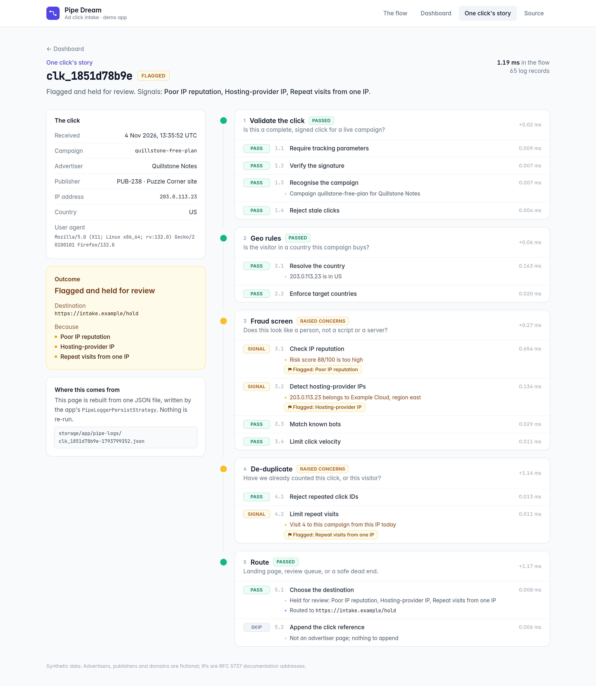

<!-- nav-group: Start here -->
# Introduction

Pipe Dream turns a Laravel pipeline into a flow you can read, and a log you can read back: every step named, timed and recorded.

Here is a three-step flow, and the log it keeps without a single line of logging code:

<!-- example: docs/examples/scripts/hub-log.php -->
```php
<?php

use Keaton\PipeDream\PipeHub;

$post = (object) ['title' => '  hello,   PIPE dream  '];

$envelope = PipeHub::create()
    ->addPipes([
        fn ($post) => $post->title = trim($post->title),
        fn ($post) => $post->title = preg_replace('/\s+/', ' ', $post->title),
        fn ($post) => $post->title = ucwords(strtolower($post->title)),
    ])
    ->sendIt($post);

foreach ($envelope->logs() as $record) {
    printf("%-11s %-24s %s\n", $record['type'], $record['key'], $record['data']);
}
```

<!-- output: docs/examples/scripts/hub-log.php -->
```text
info        PipeHub:sendIt           Sending subject through all pipes
timerStart  Closure@hub-log.php:9    Executing rule Closure@hub-log.php:9
returnValue Closure@hub-log.php:9    hello,   PIPE dream
timerEnd    Closure@hub-log.php:9    Finished executing rule Closure@hub-log.php:9
timerStart  Closure@hub-log.php:10   Executing rule Closure@hub-log.php:10
returnValue Closure@hub-log.php:10   hello, PIPE dream
timerEnd    Closure@hub-log.php:10   Finished executing rule Closure@hub-log.php:10
timerStart  Closure@hub-log.php:11   Executing rule Closure@hub-log.php:11
returnValue Closure@hub-log.php:11   Hello, Pipe Dream
timerEnd    Closure@hub-log.php:11   Finished executing rule Closure@hub-log.php:11
info        PipeHub:sendIt           Finalized result!
```

Every step was timed, and what each one returned was recorded. A plain Laravel pipeline hands you the final value and nothing else; a `PipeHub` hands you the receipt.

## What you get

- **A flow that reads like a table of contents.** Steps are closures or small named classes (*rules*), grouped into hubs, and hubs stack into one flow.
- **A log of every run.** Each step is timed and what it returned is recorded, with no logging code of your own.
- **Control over failure.** Skip a step, stop a flow early, redirect, or catch a failure without losing the log.
- **Saved runs.** Store every log and query it later: which runs hit problems, and exactly where.

## Where it fits

Laravel ships `Illuminate\Pipeline\Pipeline`: it sends a value through a list of steps and returns the final value. A `PipeHub` does the same job and keeps notes. Pipe Dream is not a workflow engine. It does not schedule work, retry steps or run anything in the background: a flow runs in order, in one process, and hands you back its log.



*One real click, replayed from a saved log: every stage, every pass, skip and flag.*

Next: [Requirements and installation](01-installation.md).
